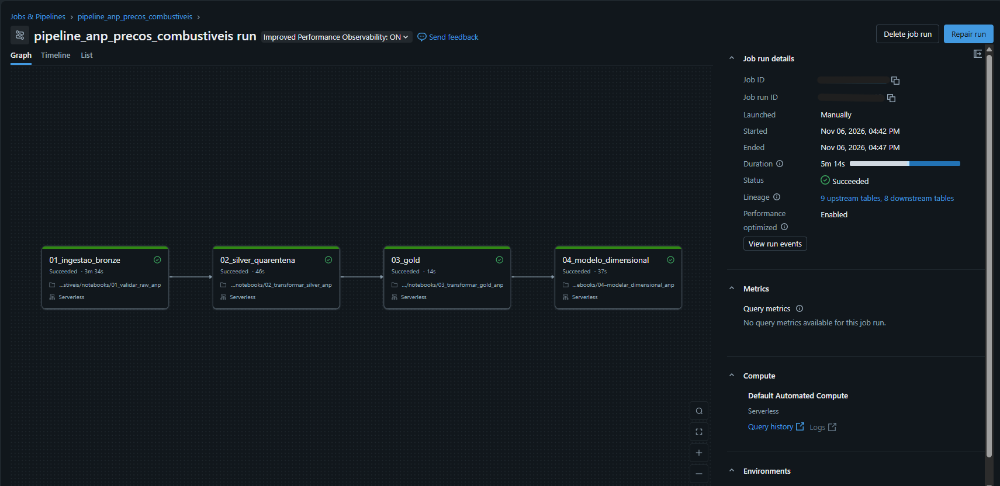
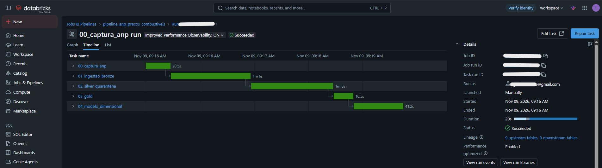
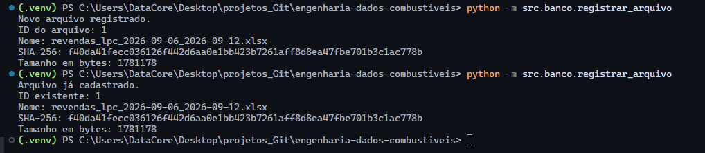
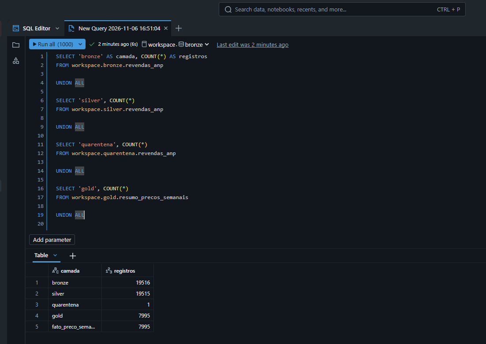
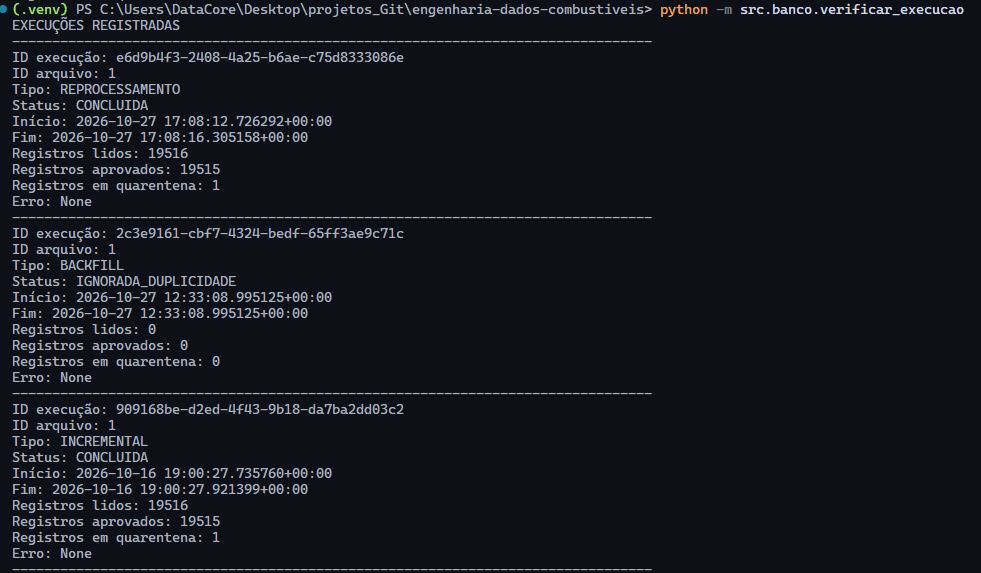
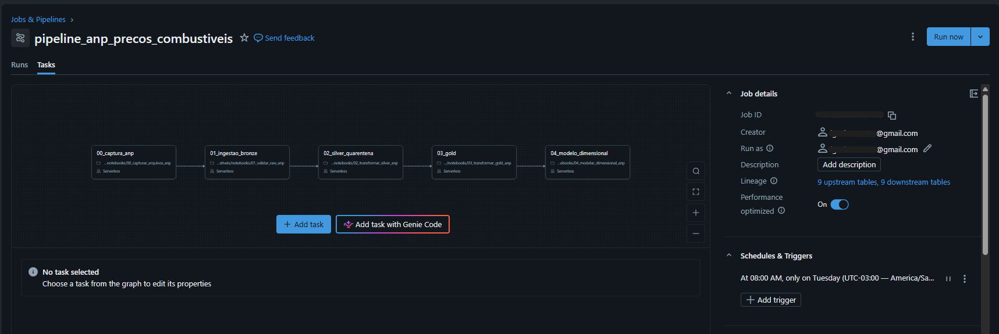
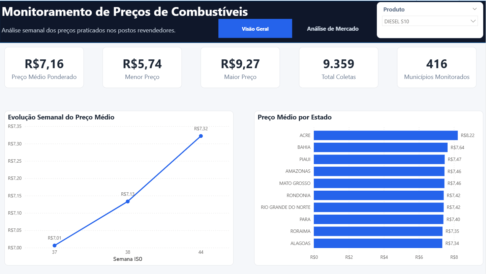
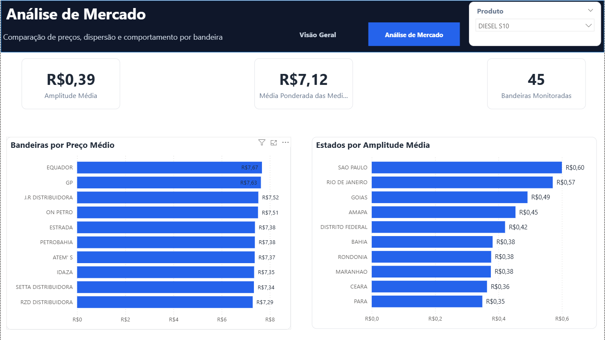

# Pipeline de Engenharia de Dados para Inteligência de Preços de Combustíveis

Projeto de Engenharia de Dados desenvolvido para automatizar a captura, processamento, validação e análise dos preços de combustíveis disponibilizados semanalmente pela Agência Nacional do Petróleo, Gás Natural e Biocombustíveis (ANP).

O projeto utiliza uma arquitetura Lakehouse no Databricks, processamento incremental, controles de qualidade e uma camada analítica consumida pelo Power BI.

## Objetivo

Construir um pipeline de dados capaz de:

- capturar automaticamente os arquivos semanais publicados pela ANP;
- preservar os arquivos originais em uma camada RAW;
- evitar reprocessamento de arquivos já ingeridos;
- estruturar os dados nas camadas Bronze, Silver, Quarentena e Gold;
- aplicar regras de qualidade para CNPJ, CEP e registros inconsistentes;
- criar um modelo dimensional para consumo analítico;
- orquestrar todo o processo de forma automática no Databricks;
- disponibilizar indicadores e análises em um dashboard Power BI.

---

## Arquitetura

O fluxo principal do projeto segue a arquitetura:

`ANP → RAW → Bronze → Qualidade → Silver / Quarentena → Gold → Modelo Dimensional → Power BI`

A execução é orquestrada por um Databricks Job composto por cinco tarefas sequenciais:

`00_captura_anp → 01_ingestao_bronze → 02_silver_quarentena → 03_gold → 04_modelo_dimensional`

O Job está configurado para execução semanal utilizando compute serverless.

---

## Captura Automática da ANP

O notebook `00_capturar_arquivos_anp.ipynb` acessa a página oficial da ANP e identifica o arquivo mais recente de preços por posto revendedor.

Após localizar o arquivo, o processo:

- realiza o download;
- calcula o hash SHA-256 do conteúdo;
- utiliza o hash como identificador do arquivo;
- armazena o arquivo original no Databricks Volume;
- verifica se o arquivo já existe na RAW;
- disponibiliza o caminho do arquivo para a próxima tarefa do Job.

Essa abordagem permite que a captura seja repetida sem gerar cópias desnecessárias.

---

## Camada RAW

A camada RAW mantém o arquivo original da ANP sem transformação.

Estrutura utilizada:

```text
/Volumes/workspace/raw/anp_arquivos/anp/{hash_sha256}/{arquivo.xlsx}
```

O SHA-256 permite identificar de forma única o conteúdo ingerido.

---

## Camada Bronze

A Bronze mantém os registros provenientes dos arquivos da ANP e adiciona metadados técnicos para rastreabilidade.

Entre os metadados adicionados estão:

```text
id_execucao
id_arquivo
arquivo_origem
data_ingestao_utc
hash_sha256
linha_origem
```

Antes da escrita, o pipeline verifica se o `hash_sha256` já foi processado.

Caso o arquivo já exista na Bronze, a nova carga é ignorada.

Esse mecanismo torna a ingestão **idempotente**.

---

## Qualidade dos Dados

A etapa de qualidade aplica regras antes que os dados sejam disponibilizados para análise.

Entre as validações implementadas estão:

- limpeza e normalização de CNPJ;
- validação de CNPJ;
- classificação e normalização de CEP;
- identificação de CEPs suspeitos;
- rastreamento da linha de origem;
- classificação dos registros conforme regras de qualidade.

Registros aprovados seguem para a Silver.

Registros que não atendem aos critérios são direcionados para a tabela de Quarentena, permitindo análise posterior sem descartar os dados.

---

## Camada Silver

A camada Silver contém os registros aprovados após as verificações de qualidade.

Ela representa a base confiável utilizada pelas próximas etapas do pipeline.

Em uma das execuções validadas do projeto:

```text
Bronze:       60.365 registros
Silver:       60.362 registros
Quarentena:        3 registros
```

Esses valores correspondem ao snapshot utilizado durante o desenvolvimento e continuarão evoluindo conforme novas semanas forem processadas.

---

## Camada Gold

A camada Gold contém os dados agregados para consumo analítico.

As principais dimensões utilizadas na agregação são:

```text
ano
semana_iso
estado
municipio
produto
unidade_medida
bandeira
```

Principais métricas:

```text
quantidade_coletas
preco_medio
preco_minimo
preco_maximo
preco_mediano
amplitude_preco
```

Uma regra importante do projeto é não combinar unidades de medida incompatíveis.

Os dados podem possuir:

```text
R$/litro
R$/m³
R$/13kg
```

Por isso, as medidas de preço no Power BI são utilizadas em contexto de produto para impedir análises incorretas.

---

## Modelo Dimensional

A camada analítica utiliza modelo estrela.

Dimensões:

```text
dim_tempo
dim_localidade
dim_produto
dim_bandeira
```

Tabela fato:

```text
fato_preco_semanal
```

As dimensões possuem relacionamento `1:*` com a tabela fato.

---

## Orquestração no Databricks

O Job `pipeline_anp_precos_combustiveis` possui cinco tarefas dependentes:

```text
00_captura_anp
       ↓
01_ingestao_bronze
       ↓
02_silver_quarentena
       ↓
03_gold
       ↓
04_modelo_dimensional
```

O agendamento atual está configurado para:

```text
Frequência: semanal
Dia: terça-feira
Horário: 08:00
Timezone: America/Sao_Paulo
```

O pipeline utiliza compute serverless e não depende da máquina local para executar.

### Pipeline Configurado no Databricks

A imagem abaixo demonstra a estrutura do Job e a dependência entre as diferentes etapas do pipeline.



### Execução Completa do Pipeline

A execução abaixo demonstra o processamento sequencial das cinco etapas, desde a captura do arquivo da ANP até a construção do modelo dimensional.



---

## Idempotência

A idempotência foi validada executando novamente o pipeline com um arquivo que já havia sido processado.

Na segunda execução, a captura reconheceu que o arquivo já existia na RAW e a Bronze identificou o SHA-256 existente.

Resultado:

```text
Arquivo já processado.
Carga Bronze ignorada para evitar duplicidade.
```

As demais etapas foram executadas normalmente sem duplicar registros.

### Evidência da Idempotência



---

## Validação das Camadas

As camadas do pipeline foram verificadas após as execuções para validar a movimentação dos registros entre Bronze, Silver e Quarentena.

A validação permite conferir se os registros seguiram corretamente pelas diferentes etapas do processo de qualidade.



---

## Histórico de Execuções

O histórico do Job permite acompanhar as execuções do pipeline, verificar o status das tarefas e confirmar o funcionamento recorrente da orquestração.



---

## Pipeline Automatizado

O pipeline completo foi configurado com cinco tarefas sequenciais e execução semanal automática.

A automação permite que novas publicações da ANP sejam processadas sem a necessidade de execução manual das etapas individuais.



---

## Dashboard Power BI

A camada Gold é consumida pelo Power BI utilizando o conector do Databricks SQL Warehouse.

O dashboard possui duas páginas principais:

- **Visão Geral**
- **Análise de Mercado**

As páginas possuem filtro de produto sincronizado e navegação integrada.

### Visão Geral

A página apresenta:

- Preço Médio Ponderado;
- Menor Preço;
- Maior Preço;
- Total de Coletas;
- Municípios Monitorados;
- Evolução Semanal do Preço Médio;
- Preço Médio por Estado.



### Análise de Mercado

A segunda página apresenta:

- Amplitude Média;
- Média Ponderada das Medianas;
- Bandeiras Monitoradas;
- Preço Médio por Bandeira;
- Amplitude de Preço por Estado.



---

## Tecnologias

```text
Python
Pandas
PySpark
SQL
Delta Lake
Databricks
Databricks Jobs
Databricks Volumes
Unity Catalog
Power BI
DAX
Git
GitHub
```

---

## Estrutura do Projeto

```text
engenharia-dados-combustiveis/
│
├── notebooks/
│   ├── 00_capturar_arquivos_anp.ipynb
│   ├── 01_validar_raw_anp.ipynb
│   ├── 02_transformar_silver_anp.ipynb
│   ├── 03_transformar_gold_anp.ipynb
│   └── 04_modelar_dimensional_anp.ipynb
│
├── src/
│   └── qualidade/
│
├── docs/
│   └── imagens/
│       ├── 01_idempotencia_arquivo_anp.png
│       ├── 01_pipeline_databricks_concluido.png
│       ├── 02_validacao_camadas_sql.png
│       ├── 03_execucao_pipeline_timeline.png
│       ├── 03_historico_execucoes_pipeline.png
│       ├── 03_pipeline_automatizado_databricks.png
│       ├── 04_dashboard_visao_geral.png
│       └── 05_dashboard_analise_mercado.png
│
└── README.md
```

---

## Principais Conceitos Aplicados

Este projeto aplica conceitos importantes de Engenharia de Dados:

- arquitetura em camadas;
- ingestão incremental;
- idempotência;
- hash SHA-256;
- rastreabilidade de dados;
- Data Quality;
- quarentena de registros;
- Delta Lake;
- modelagem dimensional;
- orquestração de pipelines;
- processamento serverless;
- integração entre Lakehouse e BI.

---

## Próximas Evoluções

Como evolução futura do projeto estão previstas:

- ampliação do histórico de preços;
- melhoria da estratégia de seleção automática dos arquivos da ANP;
- persistência de chaves substitutas nas dimensões;
- publicação do dashboard no Power BI Service;
- atualização automática da camada de BI;
- previsão de preços utilizando Machine Learning;
- detecção de comportamentos anômalos nos preços;
- monitoramento e observabilidade do pipeline.

---

## Contexto

Este projeto foi desenvolvido como projeto de portfólio, com foco na aplicação prática de conceitos de Engenharia de Dados e Analytics sobre dados públicos reais.